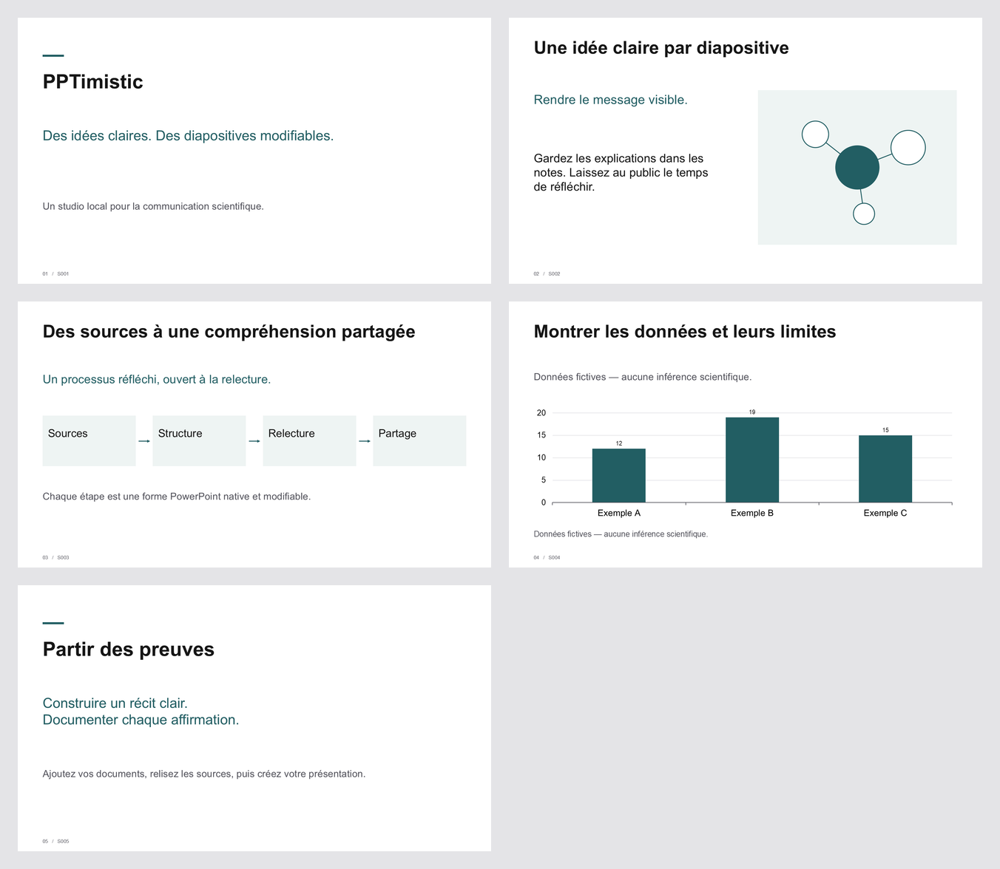

# PPTimistic

**Parce que créer des diapositives devrait donner le sourire.**

Créez des présentations PowerPoint sobres et modifiables avec un agent de programmation ou un terminal local. Conservez les sources, les illustrations, les traductions et les décisions éditoriales dans un même projet. Aucun compte, service payant ou clé API n'est nécessaire.

[English → README.md](README.md)



## Première présentation

Sur GitHub, choisissez **[Use this template → Create a new repository](https://github.com/new?template_name=PPTimistic&template_owner=dhuzard)** pour créer votre propre copie. Vous pouvez aussi cloner ou télécharger le dépôt. Installez Node.js **22.13 ou ultérieur**, puis ouvrez le dossier dans VS Code.

```sh
git clone https://github.com/dhuzard/PPTimistic.git pptimistic
cd pptimistic
npm install
npm run setup -- --ui fr
```

L'assistant demande le titre, la langue source, les langues de sortie, le style visuel et un dossier de documents facultatif. Validez les valeurs par défaut avec Entrée. Il crée une démonstration de cinq diapositives. Les graphiques utilisent des **données fictives**, sans interprétation scientifique.

Les fichiers sont enregistrés dans `projects/<nom>/output/presentation.fr-FR.pptx` et `presentation.en-US.pptx`. Textes, formes, flèches et graphiques restent modifiables. Un nouvel appel sans nom crée un nouveau dossier numéroté. Un nom explicite existant est refusé, sans écrasement.

Pour une initialisation sans interaction :

```sh
npm run setup -- --yes --project ma-presentation --ui fr --no-render
```

## Utiliser vos documents

```sh
npm run new -- --project recherche --inputs "chemin/vers/documents" --yes --ui fr
npm run build -- --project recherche
npm run validate -- --project recherche
npm run render -- --project recherche
```

Les documents sont copiés et extraits localement avec leur provenance. **L'import ne crée pas automatiquement un résumé scientifique.** Le contenu reste une démonstration fictive tant que vous ou votre agent n'avez pas rédigé les diapositives. Demandez par exemple :

> Crée cette présentation à partir de projects/recherche/inputs. Respecte l'ordre du plan, cite les sources, signale les informations manquantes et conserve les nuances scientifiques. Génère les versions française et anglaise, valide-les et montre les aperçus.

Markdown, TXT, DOCX, PDF textuels, CSV et images usuelles sont pris en charge. Les formats non reconnus sont conservés et signalés. Un plan Markdown unique peut être importé avec `--from-plan --locales fr-FR --source fr-FR` : chaque titre `##` devient une diapositive, sans réécriture du texte. Voir [l'exemple](examples/slide-plan.md).

## Illustrations et traductions

Placez vos références visuelles dans `projects/<nom>/assets/reference/`. Demandez à l'agent de les examiner et d'adapter `illustration-style.md`. Aucune analyse automatique de style n'est annoncée. La commande `npm run images -- --project recherche` prépare les prompts et la provenance. Les schémas natifs fonctionnent sans service externe. Ajoutez une illustration locale avec `--slide S002 --asset "chemin/image.png"` ; remplacer une image acceptée demande également `--authorize S002`.

```sh
npm run translate -- --project recherche --to it-IT
# Complétez les objets translation du fichier YAML indiqué, puis :
npm run translate -- --project recherche --to it-IT --file "chemin/traductions.yaml"
npm run build -- --project recherche
```

Une traduction manquante bloque l'export de cette langue. Les nombres, unités, DOI et termes protégés du glossaire sont contrôlés. La fidélité scientifique doit être relue par une personne compétente.

## Donner un retour

```sh
npm run revise -- --project recherche --slide S002 --message "Réduis le texte sans modifier le sens scientifique."
```

Le retour est consigné pour votre agent ; la commande ne prétend pas interpréter seule le langage naturel. Demandez ensuite : « Applique le retour sur S002, conserve les diapositives approuvées, puis reconstruis. » Les modifications de contenus approuvés ou verrouillés nécessitent une autorisation explicite. Les anciennes sorties sont conservées.

Les modifications effectuées directement dans PowerPoint **ne mettent pas à jour le YAML**. Un fichier PowerPoint modifié extérieurement n'est pas écrasé. Gardez une copie et demandez à l'agent de réconcilier les changements avec les sources avant de reconstruire.

## Aide

`npm run doctor` vérifie l'environnement. `npm run build -- --help` décrit les options. `npm run demo` reconstruit la démonstration existante sans remplacer son contenu. `npm run check` lance le contrôle TypeScript et les tests.

Les aperçus nécessitent LibreOffice avec `pdftoppm`, ou PowerPoint installé sous Windows. Configurez `SOFFICE_PATH` et `PDFTOPPM_PATH` si nécessaire. Leur absence ne bloque pas la création du PPTX. Arial est la police par défaut ; configurez Inter si elle est installée. Ne redistribuez pas de polices propriétaires. Les diagnostics et les commandes avancées restent principalement en anglais dans cette version.

Les projets privés sont exclus de Git par défaut, sauf les sources fictives de la démonstration. Aucun fournisseur d'IA externe n'est activé. Voir [les parcours détaillés](docs/workflows.md), [le modèle de contenu](docs/architecture.md), [la confidentialité](docs/providers.md) et [les limites](docs/limitations.md). PPTimistic est un dépôt modèle indépendant. Vos projets de présentation restent locaux, sauf si vous choisissez de les publier.
