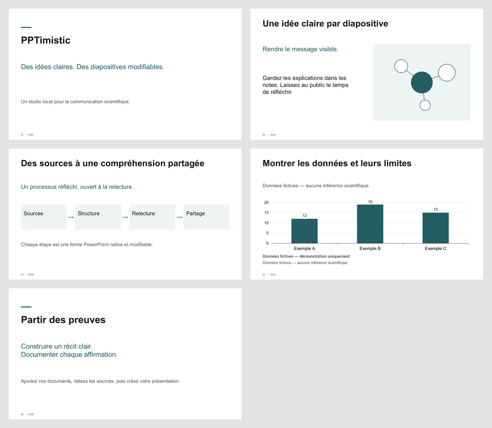

# PPTimistic

**Because making slides should feel this hopeful.**

Create clean, editable PowerPoint presentations with a coding agent or a local terminal. Keep your sources, scientific claims, illustrations and translations together in one reproducible project. No account, API key or paid service is required.

[Français → README.fr.md](README.fr.md)



## First presentation

Install Node.js **22.13 or later** before running the commands below.

### Create your own repository from the template

On GitHub, choose **[Use this template → Create a new repository](https://github.com/new?template_name=PPTimistic&template_owner=dhuzard)**. GitHub creates a new repository under your account, independent of the PPTimistic upstream repository.

Clone the repository you just created, then run setup inside it:

```sh
git clone https://github.com/YOUR-ACCOUNT/YOUR-REPOSITORY.git
cd YOUR-REPOSITORY
npm install
npm run setup
```

### Clone the upstream repository

To work from a local clone of the upstream project instead, run:

```sh
git clone https://github.com/dhuzard/PPTimistic.git pptimistic
cd pptimistic
npm install
npm run setup
```

Open the folder in VS Code if you want to work with Codex or Claude Code. Setup asks five questions: title, source language, output languages, visual preset and an optional documents folder. Press Enter to accept defaults. The wizard offers English and French; force French with `npm run setup -- --ui fr`.

Setup creates a new project and exports a five-slide demonstration. Without a project name, rerunning setup creates another numbered folder. Explicit names are never overwritten. For an unattended first run:

```sh
npm run setup -- --yes --project my-talk --no-render
```

Open `projects/my-talk/output/presentation.en-US.pptx` or `presentation.fr-FR.pptx`. Titles, paragraphs, diagram shapes, arrows and the example chart are editable. The chart contains **fictional demonstration data**. Preview generation is optional and uses installed local tools.

To start from your documents instead, create a separate project. This imports and retains files locally; it does not summarize them:

```sh
npm run new -- --project research-talk --inputs "path/to/plan-folder" --from-plan --locales en-US --yes
npm run translate -- --project research-talk --to fr-FR
# Complete every translation in the YAML request named in the command output, then:
npm run translate -- --project research-talk --to fr-FR --file "path/to/completed-request.yaml"
npm run build -- --project research-talk
npm run validate -- --project research-talk
npm run render -- --project research-talk # optional; PPTX creation does not depend on a renderer
npm run bundle -- --project research-talk
```

## Your own presentation

```sh
npm run new -- --project research-talk --inputs "path/to/documents" --yes
npm run build -- --project research-talk
npm run validate -- --project research-talk
npm run render -- --project research-talk
```

`npm run validate -- --project research-talk --source-only` checks source content and layout without checking generated PowerPoint files.

Documents are copied locally and extracted with provenance. **Importing research documents does not automatically summarize them.** Until you or your agent authors the slide content, the deck remains an explicitly fictional demo. Tell your agent:

> Create this presentation from projects/research-talk/inputs. Use the supplied sources, preserve the slide plan order, flag missing evidence, and write concise slide content and presenter notes. Generate French and English outputs, validate them, then render previews.

For direct Markdown import, use `examples/slide-plan.md` as a guide. Each `##` heading becomes a slide; its text is copied verbatim, without scientific rewriting:

```sh
npm run new -- --project planned-talk --yes --inputs "path/to/plan-folder" --from-plan --locales en-US
```

Large blocks of text fail layout validation instead of being silently shrunk. An agent can refine the source with your editorial approval.

For claims that need a precise source trail, add an optional `claims` entry linking a visible slide field to an excerpt from an ingested document, then run `npm run claims -- --project research-talk`. The local report shows the source ID, path, hash, locator and review issues without printing the excerpt itself. See the [claim schema](docs/architecture.md). A matching excerpt still needs human scientific review.
Use `npm run claims -- --project research-talk --write-markdown` for a local `output/claims-report.md` with links to retained source files and explicit source/extraction hash states. The report includes slide text and paths, so treat it as private.

For a nonfictional editable chart, ingest a CSV and explicitly bind its source hash, columns and rows in slide YAML. The chart and its embedded workbook receive the selected values directly; changed CSV bytes block a rebuild until reviewed. See the [chart binding schema](docs/architecture.md).

## Illustrations, translations and revisions

Put visual references in `projects/<name>/assets/reference/`. Ask your agent to inspect them and update `illustration-style.md`; no automated style analysis is claimed. `npm run images -- --project research-talk` writes detailed prompts and asset metadata. Native diagrams work without an image service. Attach a local illustration with `--slide S002 --asset "path/to/figure.png"`; replacing accepted assets also needs `--authorize S002`.

French and English demo content is included. Other translations can be supplied manually:

```sh
npm run translate -- --project research-talk --to it-IT
# Fill every translation object in the reported YAML file, then:
npm run translate -- --project research-talk --to it-IT --file "path/to/completed-request.yaml"
npm run build -- --project research-talk
```

Missing translations block that language's export. Numbers, units, DOIs and protected glossary terms are checked. Translation still needs scientific review.
For a fictional chart in a language beyond English or French, fill its `fictionalNotice` field with a reviewed, visible disclosure in that language; the build will otherwise stop.

```sh
npm run revise -- --project research-talk --slide S002 --message "Less text; preserve the scientific meaning."
```

Feedback is logged for your coding agent; the CLI does not pretend to interpret natural language. Say, “Apply the feedback on S002 and rebuild; keep approved slides unchanged.” Structured revisions are supported too; see [the workflow guide](docs/workflows.md). Approved or locked content requires explicit authorization for changes. Each successful rebuild keeps earlier output versions. Manually modified PPTX files are detected and never overwritten.

For local delivery, run `npm run bundle -- --project research-talk`. It verifies current PPTX files and creates `output/deliveries/<id>/` with the decks, validation results and a hash manifest. Add `--previews latest` to include current rendered previews. Original inputs are excluded unless you name each file with `--input inputs/filename`; inspect the bundle before sharing it.

## Continuous integration previews

GitHub Actions checks Node 22.13 and 24 on Linux, macOS and Windows. The Linux Node 22.13 job renders the public typography fixture and uploads only its preview images and `qa-manifest.json` for seven days. The manifest records renderer, locale, theme, slide IDs and images still needing human inspection; CI does not claim visual or screen-reader inspection.

## Help and troubleshooting

```sh
npm run doctor
npm run build -- --help
npm run demo
npm run check
```

If previews are unavailable, install LibreOffice plus `pdftoppm` (Poppler); Windows can also use installed PowerPoint. Set `SOFFICE_PATH` or `PDFTOPPM_PATH` if detection fails. The render command reports the missing local tools and the PPTX remains available. For “Input folder not found,” check the full path and pass the directory containing the files; use `--from-plan` only with exactly one Markdown file containing `##` slide headings. Setup checks Node, dependencies and writable storage before creating a project; `npm run doctor` reports which prerequisite needs repair. Set `font` in project YAML to an installed font; Arial is the portable default, and Inter is preferred when available. Do not redistribute proprietary fonts.

For “externally modified PPTX,” keep a separate copy and reconcile its changes into YAML before rebuilding. Direct PowerPoint edits do **not** update source files. Never delete the output or history until edits have been reconciled. For “missing translation” or “text overflow,” complete the translation or shorten the relevant slide; validation identifies its stable ID.

The CLI processes presentation files locally and makes no AI network calls. A coding agent is a separate service with its own data handling: if you use one, the agent and its connected tools may transmit source documents, extracted text or prompts outside your computer. Review that agent's configuration and policies, and do not expose confidential material unless you have explicitly approved the destination and scope. External providers in this project are extension interfaces only; no network AI provider is enabled or called by the CLI.

Project folders are ignored by Git by default, except the public fictional demo source. Do not add confidential inputs or generated materials to a public repository.

See [architecture and content schema](docs/architecture.md), [workflows and manual edit reconciliation](docs/workflows.md), [privacy and providers](docs/providers.md), and [release limitations](docs/limitations.md). PPTimistic is a standalone GitHub template. The CLI keeps project files local unless you deliberately publish them; review an agent's separate data handling before using one.
